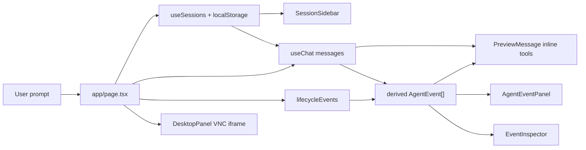

Author: Haochen Xu

# AI SDK Computer Use Dashboard

Live: https://ai-agent-dashboard-three-steel.vercel.app/  
Demo: [`demo.mp4`](./demo.mp4)

## Code Map

- Dashboard layout and session wiring: `app/page.tsx`
- Inline tool call cards: `components/message.tsx`
- Collapsible event store view: `components/agent-event-panel.tsx`
- Expanded event inspector: `components/event-inspector.tsx`
- VNC render isolation: `components/desktop-panel.tsx`
- Typed event logic: `lib/agent-events.ts`, `lib/agent-event-stats.ts`
- Session persistence: `lib/use-sessions.ts`, `lib/session-store.ts`

## Component Map and Data Flow



There are two source-of-truth layers:
- At runtime, `useChat.messages` owns the active transcript. 
- Across reloads and inactive sessions, `localStorage` owns the persisted session body: messages, lifecycle events such as session creation, VM creation/reconnect/kill and chat errors, and the current sandbox binding.

`AgentEvent[]` is a derived view over `messages + lifecycleEvents`, not a second transcript store. It feeds both the inline tool cards and the debug surfaces.

Event model in one pass:

- Tool events are projected from `messages.parts[].toolInvocation`.
- Turn events are projected from `messages`.
- Lifecycle events, such as session creation, VM creation/reconnect/kill and chat errors, are stored separately because AI SDK messages do not contain session or sandbox lifecycle facts.
- Persisted sessions store `messages + lifecycleEvents + sandboxId`; restoring a session puts `messages` back into `useChat`.

## Key Decisions

**Event log as a derived in-memory view.**

- The event log is computed from `messages`, not stored as its own persistent table.
- Once a session is active, `useChat.messages` is the authoritative transcript.
- Tool and turn events are projected from it; lifecycle events are stored separately because AI SDK messages do not contain them.
- This repeats a linear projection, `O(active session messages + parts)`, when `messages` changes.
- That cost is bounded by `maxSteps`, runs only for the active session, keeps event objects light, and reads raw screenshots only when an event is selected.
- The trade-off keeps the debug UI from drifting away from the transcript sent back to the model or persisted for restore.

See `docs/event-model.md`.

**Durable conversation identity.** `useChat` is keyed by session id, not sandbox id, so a conversation survives desktop expiry, reconnects and replacement VMs without being treated as a new chat.

**Server-measured tool timing.** Tool duration is measured inside the server-side sandbox executor, not from browser stream observation time. The event log reports VM action time instead of model, network or React render latency, and the metadata rides in the tool result so restored sessions keep the same timings.

**Stable event ordering.** Chat can render directly from the `messages` array, but the event log merges three sources: turns from `messages`, tool calls from message parts, and lifecycle events recorded by the page. Timestamps come from different clocks, so they are display-only. Ordering is based on each event's position in the transcript: `messageIndex * ORDER_BLOCK + slot`, where slot `0` is the turn and later slots are tool parts. That keeps the timeline stable when a pending tool receives server timing or when browser and server clocks disagree.

**Stream-friendly localStorage persistence.** The storage layer works around localStorage's two constraints: synchronous writes and a small per-origin quota, typically 5 MiB for localStorage. Streaming updates are debounced and flushed on `pagehide`; screenshot redaction and old-session eviction keep storage pressure visible and recoverable while preserving the `tool_use` / `tool_result` structure Anthropic requires.

**VNC outside chat churn.** The VNC iframe is isolated from chat and event state so streamed tokens do not remount or reload the desktop connection. `DesktopPanel` receives only stable desktop props, is memoized, and is mounted once per responsive layout to avoid duplicate VNC clients.

**Relay-compatible tool mode.** Anthropic's native computer/bash tools are provider-defined and do not carry an `input_schema`. Some Anthropic-compatible relays drop those tool definitions, which made the model emit `computer` calls with empty input. `COMPUTER_TOOL_MODE=schema` re-declares the same surface as normal schema tools for relays; `native` keeps the trained provider-defined tools for the official API. See `docs/model-access-notes.md`.

## Validation

- `pnpm test` — 69 tests
- `npx tsc --noEmit`
- `npm run lint`
- `npm run build`

## Local Run

```bash
pnpm install
cp .env.example .env.local
pnpm dev
```

Required environment is documented in `.env.example`: `ANTHROPIC_API_KEY`, `SANDBOX_SNAPSHOT_ID`, and Vercel Sandbox credentials.

## Milestones

1. [Portable model access and a relay-safe tool layer](https://github.com/hcsum/ai-agent-dashboard/pull/1)
2. [Event model spec for the agent pipeline](https://github.com/hcsum/ai-agent-dashboard/pull/2)
3. [Typed agent event pipeline with a live timeline panel](https://github.com/hcsum/ai-agent-dashboard/pull/3)
4. [Turn the event timeline into an inspectable dashboard](https://github.com/hcsum/ai-agent-dashboard/pull/4)
5. [Multiple sessions, over one useChat](https://github.com/hcsum/ai-agent-dashboard/pull/5)
6. [Persisted screenshots, a reachable inspector, dock legibility](https://github.com/hcsum/ai-agent-dashboard/pull/6)

## Known Limitation

Against a shared relay (`ANTHROPIC_BASE_URL`), the gateway intermittently returns a 503 reading `无可用渠道 / no available channel`: no upstream slot for that model at that instant. Requests retry with backoff; if all attempts fail, the UI offers Retry and records the response as a `chat_error` event.
